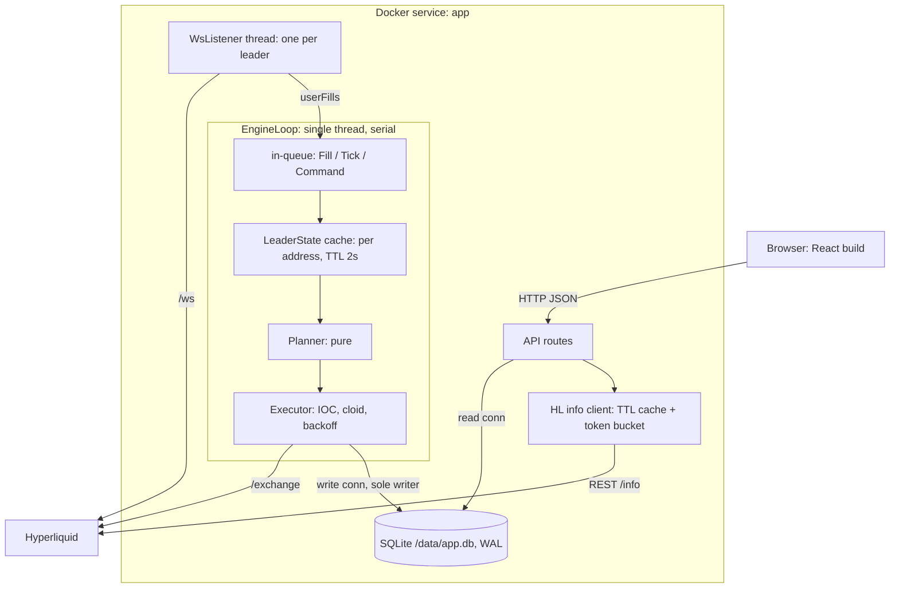
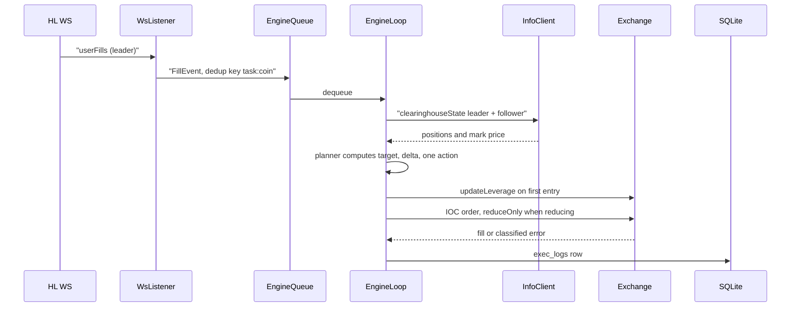

# 架构（施工视图）

> `docs/PLAN.md` 是权威设计（决策表、取舍、AC 映射、数据模型原文）。
> 本文是它的可施工压缩版：进程拓扑、模块边界、运行路径与实现约束。
> 两者冲突时以 `docs/PLAN.md` 为准，并回改本文。

状态：设计已定稿，实现未开始。Ticket 见 GitHub Issues（`[T01]`–`[T12]`）。

---

## 1. 部署与进程拓扑

一个 Docker 服务、一个 uvicorn worker、三种并发单元（HTTP 请求处理、引擎线程、每个 leader 一个 WS 线程）。



由此拓扑直接得出三条不变量：

1. **只有一个 SQLite 写者**（引擎线程）。
2. **只有一条下单路径**（`EngineLoop` 串行处理），`(task, coin)` 的在途互斥由"正在处理"本身保证，无需锁。
3. **只有一个异步↔同步边界**（WS 线程 → 引擎队列）。

### 读写连接分工

| 使用者 | 连接 | 方式 |
|---|---|---|
| 引擎线程 | 独立 `sqlite3` 连接 | 唯一写者；WAL 下写入不阻塞读 |
| API 请求 | 每次读取时短连接或线程本地连接 | 只读查询；不做长事务 |

`sqlite3` 连接不跨线程共享（`check_same_thread` 默认语义）。WAL 模式在启动建表时设置一次。

---

## 2. 模块边界与依赖方向

```
api ───┐
engine ─┼──▶ hl/ (info, exchange, ws, rounding) ──▶ network
db   ◀─┘        planner: 零外部依赖
```

| 模块 | 职责 | 硬约束 |
|---|---|---|
| `api/` | HTTP 路由、DTO | 数值出参一律字符串；不写业务表 |
| `engine/planner.py` | 目标、增量、动作决策 | 不 import `hyperliquid`，不碰 DB，不做网络 |
| `engine/loop.py` | 队列、分发、定时器、housekeeping | 唯一下单者；每个 task 包 try/except |
| `engine/executor.py` | 执行动作、反手两笔、退避 | 只执行不判断；失败写 `exec_logs` |
| `engine/leader.py` | leader 状态缓存、解锁判断 | 缓存键为 leader 地址 |
| `hl/info.py` | `/info` 客户端、TTL 缓存、限频 | 缓存键为地址；权重按请求类型 |
| `hl/exchange.py` | EIP-712 签名、nonce、order/cancel/leverage | 唯一解密点，唯一造签名处 |
| `hl/ws.py` | `userFills` 监听、重连、补漏 | 不计算仓位，只投递事件 |
| `hl/rounding.py` | 价格/数量取整 | 纯函数，Decimal 输入输出 |
| `db.py` | schema、迁移、仓储 | 单写者；数值列 TEXT |

依赖方向单向：`api`/`engine` 可以依赖 `hl` 与 `db`，反向不允许。`planner` 与 `rounding` 必须能被单测直接 import，不触发任何 I/O。

---

## 3. 引擎每轮做什么

事件只是提醒，不是指令：每一轮都从 leader 与 follower 的最新全量状态重算。



三种触发源（`FillEvent`、`TickEvent`、`CommandEvent`）走完全相同的代码路径，区别只在 `source` 字段与日志原因。

---

## 4. 单币种决策漏斗

按优先级自上而下，命中即返回；每币种每轮只有一个动作和一个 `reason`。

```
0   |T|·mark > maxNotional      → 截断 T
1   task.status != running      → 短路（task_paused / task_stopped）
2   leader 状态不可用            → 跳过（leader_state_unavailable）
3   next_retry_at 未到          → 跳过（backoff）
4   locked 且 L != 0            → 跳过（locked）
5   locked 且 L == 0            → 解锁，本轮不下单（unlocked）
6   T == 0 且 F == 0            → 无动作（no_position）
7   T == 0 且 F != 0            → reduceOnly 全平 |F|（close_all）
8   |Δ|·mark < 10               → 跳过（below_min_notional）
9   sign(T) != sign(F)          → 两笔：先平后开（reverse）
10  首次在该币种开仓            → set_leverage → 下单
11  其余                        → IOC 下 Δ（place）
```

反手拆两笔是刻意的：`reduceOnly` 不能穿越零点，单笔穿越会把仓位放大到目标之外。

---

## 5. 状态与数据所有权

| 表 | 写者 | 读者 | 关键约束 |
|---|---|---|---|
| `wallets` | API | API、engine | `address` UNIQUE；`secret_enc` 只存密文 |
| `tasks` | API | 全部 | 数值列 TEXT（Decimal 字符串） |
| `coin_states` | engine | API | 主键 `(task_id, coin)`；锁定、杠杆、退避 |
| `exec_logs` | engine | API（日志页） | 追加写；`raw` 已遮罩 |

运行期内存状态只有两处：

- **每签名地址的 nonce 计数器**：`max(now_ms, last+1)`，重启后 `now_ms` 天然大于历史值。
- **leader 状态缓存**：按地址共享，TTL 2s，使多个 follower 跟同一 leader 只拉一次。

锁定状态、杠杆已设置、退避到期时间都落库，因此进程重启后行为可恢复。

---

## 6. 一次跟单的时间预算

```
leader fill --WS--> 入队(~0) --> 全量状态(2 次 /info) --> planner(µs)
             --> IOC 下单 --> 结果回写
目标：10 秒内完成；30 秒定时对账兜底（要求 < 60s）
```

敏感点：两次 `/info` 串行读在最坏网络下约 200–400ms；IOC 可能部分成交，由下一轮收敛，不追求单轮完美。

---

## 7. Ticket 与架构层对应

| Ticket | 打通的结构 |
|---|---|
| T01 | 容器、uvicorn、建表、静态挂载、health 骨架 |
| T02 | `wallets` + crypto + API + 钱包页 |
| T03 | `hl/info.py`、缓存、限频、账户面板 |
| T04 | `tasks` + `rounding` + `planner` + 对比页（无下单） |
| T05 | `hl/exchange.py`、nonce、错误分类、日志遮罩 |
| T06 | `exec_logs` + `executor` 首次建仓 + 日志页 |
| T07 | Tick 路径 + 完整决策表 + 退避 |
| T08 | `hl/ws.py` + 引擎队列 + 去重 |
| T09 | `coin_states.locked` 双来源解锁 |
| T10 | 任务生命周期与 `CommandEvent(param)` |
| T11 | 重启恢复 + cloid 幂等收口 |
| T12 | 交付文档与 AC 自查 |

---

## 8. 实现约束清单

- uvicorn 必须单 worker；`docker compose` 只起一个 app 副本。多副本会让"单写者"与串行互斥同时失效。
- 数值全程 `decimal.Decimal`，取整用 `Decimal.quantize(..., ROUND_DOWN)`；`float` 不得进入下单参数、比较或 DB 写入。
- 签名器与解密都是短生命周期对象，仅在 `hl/exchange.py` 构造。
- 私钥与 64-hex 形态字符串在日志、`exec_logs.raw`、异常消息中一律遮罩。
- `HL_SECRET_ENC_KEY` 缺失时启动即失败，没有明文兜底。
- 读 leader 失败等同于"不知道"，绝不等同于"空仓"。
- `cloid` 由 `(task_id, coin, target, reverse_leg)` 确定性生成，重试复用；重复 cloid 视为上次成功。
- 只有默认 perp universe（`/info meta` 内）的币种参与跟单，HIP-3 一律忽略。

---

## 9. 已定的实现选择

| 项 | 决定 | 落地点 |
|---|---|---|
| Python 依赖管理 | `uv`，提交 `uv.lock`，镜像内 `uv sync --frozen` | `backend/pyproject.toml`、Dockerfile |
| 前端包管理 | `npm`，提交 `package-lock.json`，镜像内 `npm ci` | `frontend/package.json`、Dockerfile |
| 看板刷新 | 3 秒轮询；不做 SSE | T03 的账户面板 |
| Hyperliquid 接入 | 官方 `hyperliquid-python-sdk`，不手写签名与序列化 | `hl/` 适配层 |
| 引擎位置 | FastAPI 进程内的独立线程，不另起容器或消息队列 | T01 启动逻辑 |
| 前端托管 | 构建产物由 FastAPI 静态挂载，不单独跑 nginx | T01 静态挂载 |
